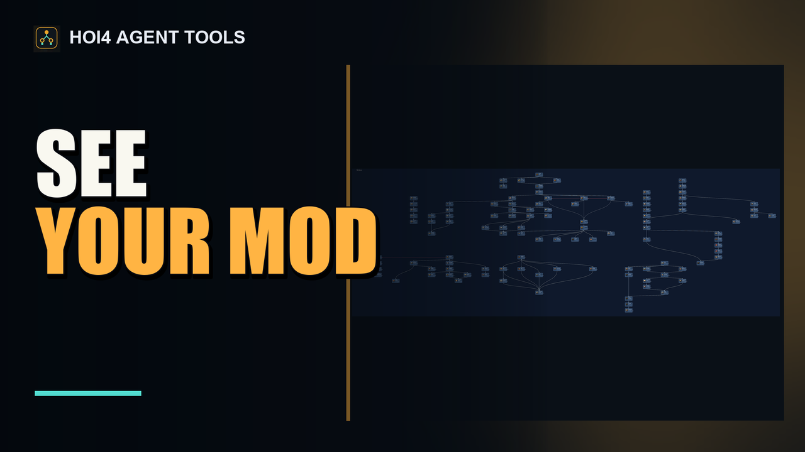
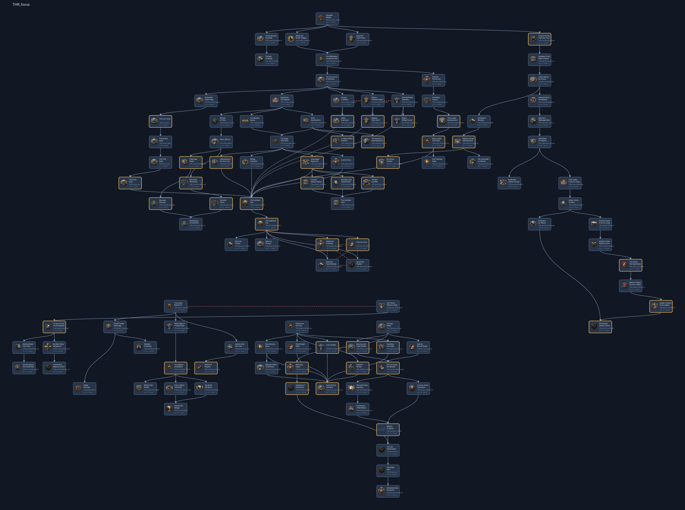
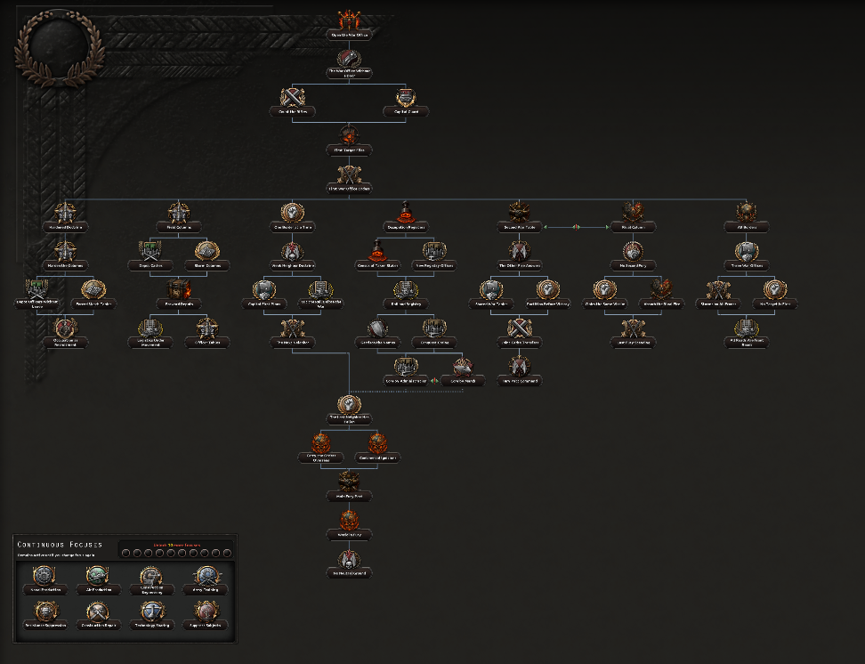
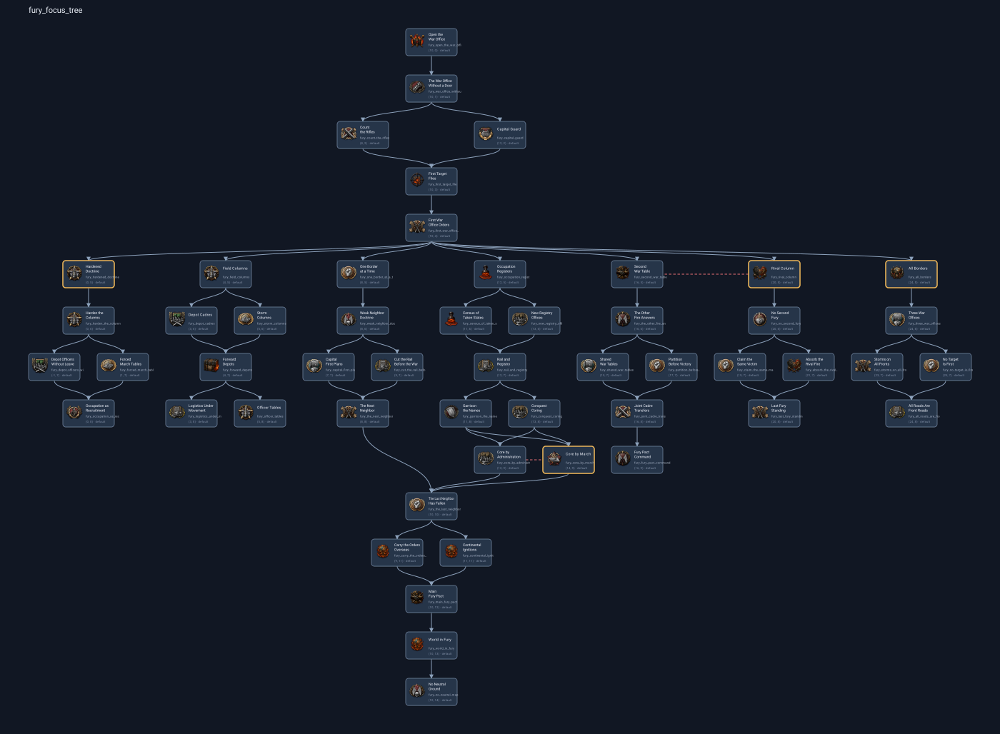
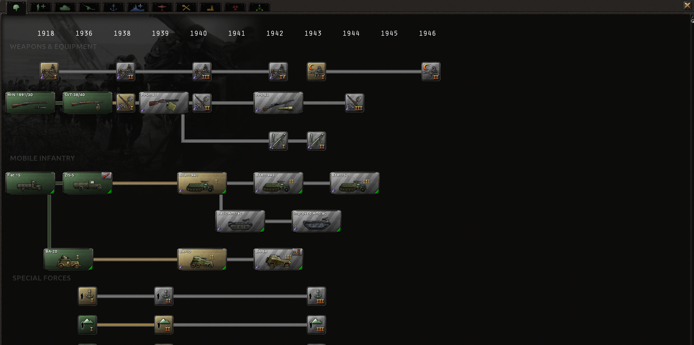
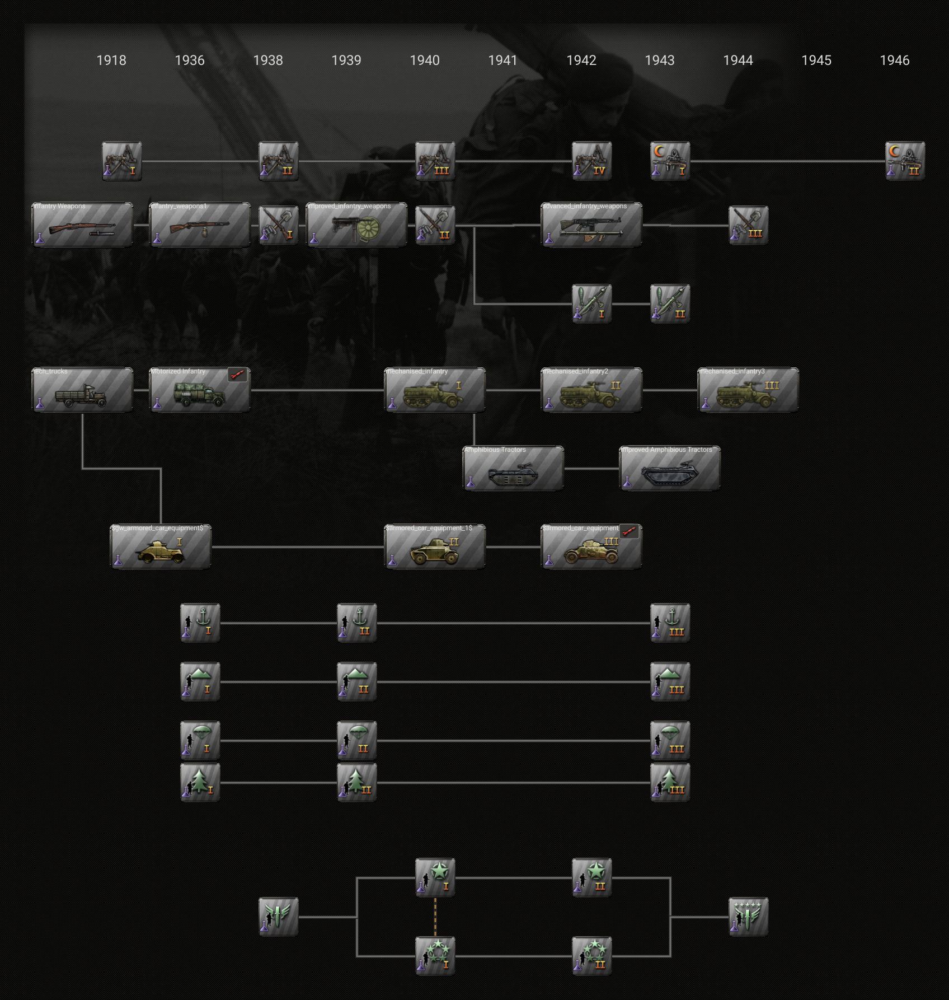
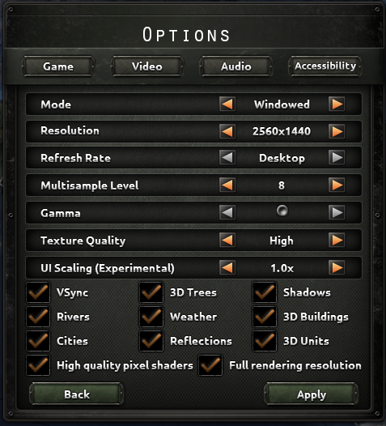
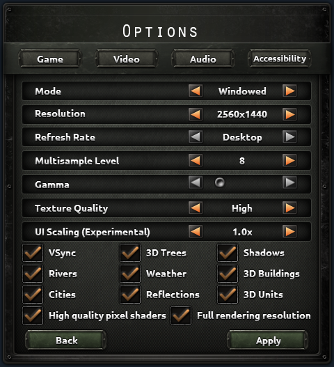

# HOI4 Agent Tools

[](https://www.youtube.com/watch?v=Dd36E_NK4rQ)

[](https://www.npmjs.com/package/hoi4-agent-tools)
[](https://nodejs.org/)
[](LICENSE)
[](https://discord.gg/rAXesGcT2t)
[](https://www.youtube.com/@ChaosRedux)
[](https://ko-fi.com/klimpaskov)
[](https://github.com/klimPaskov/hoi4-agent-tools/releases/latest)
[](https://github.com/klimPaskov/hoi4-agent-tools/issues)

An [MCP](https://modelcontextprotocol.io/) server that helps coding agents build and edit Hearts of Iron IV mods.
Make focus trees, events and decisions. Edit maps and generate a new world. Preview windows, trees and maps, find the right rule in the docs, fix broken script and balance AI choices.

## What it does

Your agent can build and edit focus trees, events, decisions and maps, and generate a new world.
It previews focus trees, technology folders, windows and maps, finds the right rule in the game's documentation, fixes broken script and tunes AI choices.
You describe what you want; the agent picks the right tools.

## Quick start

1. Install [Node.js](https://nodejs.org/) 22 (22.19 or later) or 24, and keep Hearts of Iron IV installed for vanilla files, artwork and fonts.
2. Install the server:

   ```bash
   npm install --global hoi4-agent-tools
   ```

3. Print the client configuration:

   ```bash
   hoi4-agent-tools-setup --print-client-config
   ```

   Paste the `globalInstall` block into a JSON client such as Claude Code, Claude Desktop or Cursor, or the `codexTomlGlobal` block into Codex's `config.toml`.

4. Open your mod folder as the agent's workspace and tell it what you want to build or fix.

The [setup guide](docs/setup.md) covers several mods, explicit game paths, local wiki snapshots and troubleshooting with `--discover` and `--diagnose`.

[Watch the Agent Tools demo](https://github.com/klimPaskov/Agentic-HOI4-Modding/releases/latest/download/hoi4_agent_tools_promo.mp4) or use [HOI4 Mod Setup](https://github.com/klimPaskov/HOI4-Mod-Setup/releases/latest) to install and connect the server for your mod.
Part of the HOI4 modding toolkit with [Agentic HOI4 Modding](https://github.com/klimPaskov/Agentic-HOI4-Modding) (skills and instructions for your agent) and [HOI4 Live Tools](https://github.com/klimPaskov/HOI4-Live-Tools) (testing in the running game).

## Examples

[](docs/images/comparisons/holy-realm-mcp.png)

Each pair shows a capture from the game next to the server's preview of the same source.

| In game                                                                                                                                | Server preview                                                                                                                   |
| -------------------------------------------------------------------------------------------------------------------------------------- | -------------------------------------------------------------------------------------------------------------------------------- |
| [](docs/images/comparisons/fury-ingame.png)                              | [](docs/images/comparisons/fury-mcp.png)                              |
| [](docs/images/comparisons/infantry-ingame.png)      | [](docs/images/comparisons/infantry-mcp.png)      |
| [](docs/images/comparisons/gui/options-video-ingame.png) | [](docs/images/comparisons/gui/options-video-mcp.png) |

See more in the [examples gallery](docs/examples.md).

## Tools

The server gives your agent previews, documentation, script analysis and editing tools.
The agent combines them with its file editor to build events and decisions, repair scripts and adjust AI weights.
The [tool reference](docs/tools.md) lists exact names, arguments and results for integrations.

## FAQ

**Where do edits go?** Changes are written to your mod folder; use Git to review or undo them.

**Does it run the game?** No. Previews come from mod source; test gameplay in HOI4 to see live clicks, AI choices and timing.

## Configuration

Started inside a mod folder, the server needs no configuration file.
`hoi4-agent-tools-setup --init` writes one when you work on several mods or the game is not found automatically.
For remote or shared use, `hoi4-agent-tools-http` serves the same tools over HTTP with tokens or OAuth.
See the [configuration reference](docs/configuration.md) and the [HTTP guide](docs/http.md).

## Documentation

- [Setup](docs/setup.md) and [configuration](docs/configuration.md)
- [Examples](docs/examples.md) and [tool reference](docs/tools.md)
- Guides: [local references](docs/reference.md), [focus trees](docs/focus.md), [scripted GUIs](docs/gui.md), [maps](docs/map.md), [events](docs/events.md), [technology](docs/technology.md), [AI weights and timing](docs/probability.md), [decisions and impact](docs/analysis.md), [mechanic and package tests](docs/mechanics.md)
- [Background jobs](docs/jobs.md) and [HTTP](docs/http.md)
- [Development](docs/development.md), [changelog](CHANGELOG.md) and [security policy](SECURITY.md)
- [Documentation index](docs/README.md)

## Development

```bash
npm ci
npm run check
```

See the [contributing guide](https://github.com/klimPaskov/hoi4-agent-tools/blob/main/CONTRIBUTING.md) and the [development guide](docs/development.md).

## License

Apache-2.0; see [LICENSE](LICENSE) and the [third-party notices](docs/third-party-notices.md).
Hearts of Iron IV artwork belongs to Paradox Interactive; this project is unaffiliated with Paradox Interactive.
The in-game captures were supplied for these comparisons.
