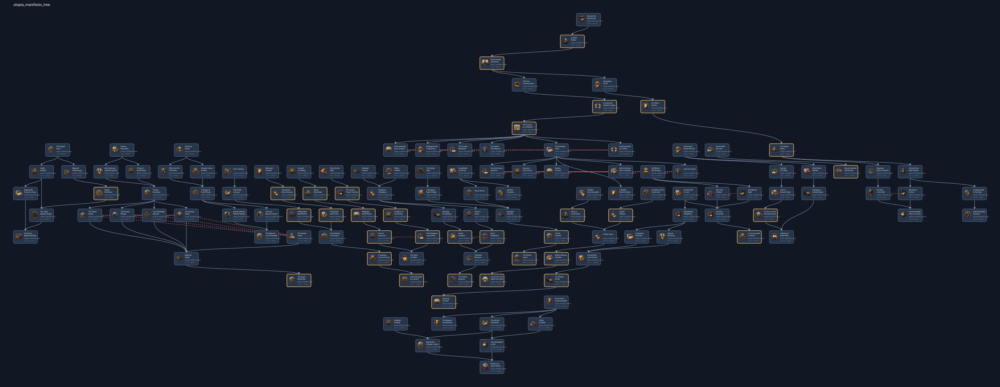
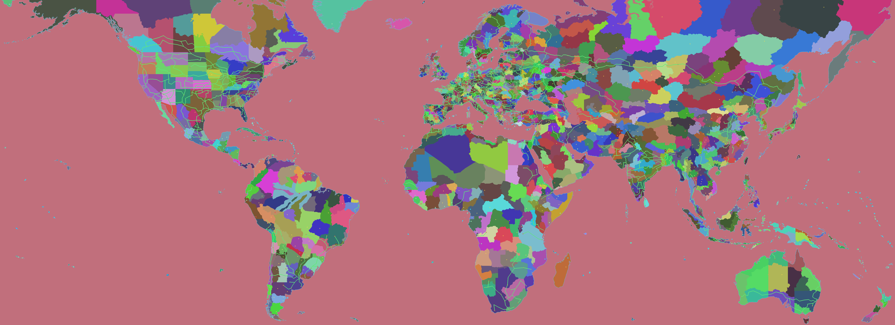
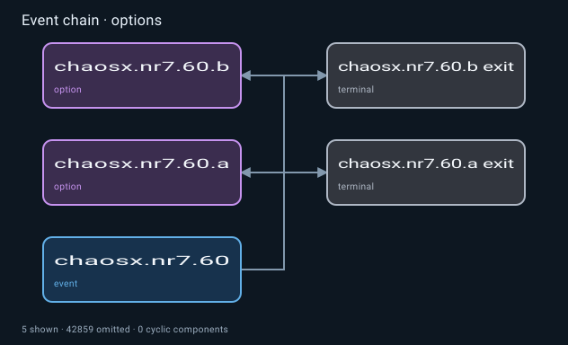

# Examples

Describe what you want to make or fix and the agent chooses the tools.
The previews below come from real mod and installed HOI4 files.

## Find a rule without reading a whole wiki

The reference tools find the section, read a small excerpt, and retain its source revision so the agent can return to it later.
In the [measured reference example](research/reference-benchmark.md), the search found the installed effect documentation first and a 12-line read supplied the command and supported scopes.
No wiki download or game launch was needed.

Use [Local references](reference.md) to configure an offline wiki snapshot or narrow a search.

## Review a large tree

Open the image at full size for the complete layout.
The [focus guide](focus.md) covers inspecting, rendering and reorganizing trees.

## Preview technology layouts and artwork

The preview follows the loaded technology and GUI definitions, including wide equipment cards.
The [technology comparisons](https://github.com/klimPaskov/hoi4-agent-tools/blob/main/docs/visual-comparisons.md#technology-folders) also show a mod folder with wide equipment cards rendered from a matching recorded source revision.
See the [technology guide](technology.md) for grants, bonuses and doctrine paths.

## Preview a window

| Supplied in-game capture                                                  | MCP source preview                                                     |
| ------------------------------------------------------------------------- | ---------------------------------------------------------------------- |
|  |  |

The agent can preview mod windows at different UI scales and work out which state values their controls need.
Unknown state values must stay unresolved; a visible button alone does not establish that it is enabled in the game.
The [interface gallery](https://github.com/klimPaskov/hoi4-agent-tools/blob/main/docs/gui-comparisons.md) includes a vanilla priority panel, a mod settings window, an event log, a status panel, and the decision and occupation views.

## Reshape a map

The agent finds the state, splits its provinces and updates connected map records and script references.
It can also build a whole world from a drawing.
See [Maps](map.md) for supported edits.

## Trace an event or compare AI weights

The AI tools show why a route is favoured or ignored.
Use [Events](events.md) for route graphs and [AI analysis](probability.md) for supported weights, chances and timing models.
A decision score is not automatically a percentage chance of an AI click.

## About these examples

The images are source previews, not recordings of the server running the game.
Supplied game screenshots are identified separately and published with permission.
The [comparison pages](https://github.com/klimPaskov/hoi4-agent-tools/blob/main/docs/visual-comparisons.md) and [interface gallery](https://github.com/klimPaskov/hoi4-agent-tools/blob/main/docs/gui-comparisons.md) keep source details, reproducible inputs and known differences alongside the images.
The package does not include HOI4 or mod source files or artwork.
